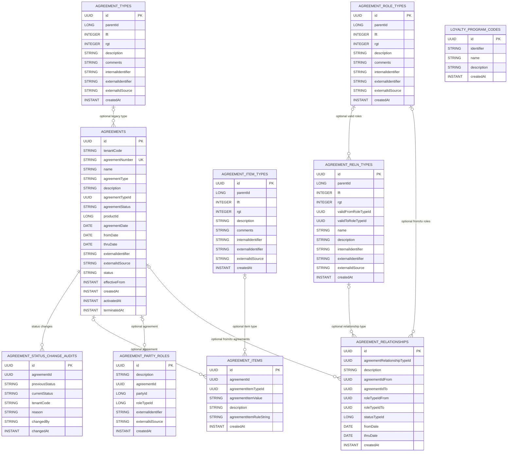

# Agreements Module Data Model (High-Level)

Updated: 2026-10-15

## Entity Diagram

## Relationship Notes

- The agreement master, agreement type, item type, and item records remain internal to the Agreements module.
- `tenantCode` is normalized to uppercase and currently scopes list queries.
- `agreementNumber` is the external business identifier and is normalized to uppercase.
- `agreementNumber` is also the direct-read lookup key for `GET /api/agreements/{agreementNumber}`.
- `agreementType` is stored as an uppercase normalized string for consistent filtering/parity expansion.
- Legacy-compatible agreement master fields:
  - map `description`, `agreement_type_id`, `agreement_status`, `product_id`, `agreement_date`, `from_date`, `thru_date`, `external_identifier`, and `external_id_source`
  - preserve nullable legacy values alongside the required Java workflow fields
  - validate `agreementTypeId` when supplied; `productId` remains a logical legacy `Long` reference
  - use `LocalDate` for legacy date-only columns and do not impose range rules absent from the legacy model
- `status` starts as `DRAFT` and currently supports transitions:
  - `DRAFT -> ACTIVE`
  - `DRAFT -> TERMINATED`
  - `ACTIVE -> TERMINATED`
  - `TERMINATED` is final (except same-state no-op calls)
- Transition timestamps:
  - `activatedAt` set when agreement transitions to `ACTIVE`
  - `terminatedAt` set when agreement transitions to `TERMINATED`
  - when `ACTIVE -> TERMINATED`, `activatedAt` remains populated and `terminatedAt` is set
- Immutable status history:
  - each successful status transition appends one row to `agreement_status_change_audits`
  - transition requests require attribution metadata (`tenantCode`, `reason`, `changedBy`)
  - transitions validate `changedBy` against `identity` module actor lookup within `tenantCode`
  - history is exposed via `GET /api/agreements/{agreementNumber}/status-history?page=&size=&tenantCode=&changedBy=&changedAtFrom=&changedAtTo=`
  - history rows include `tenantCode`, `reason`, and normalized-lowercase `changedBy`
  - no-op transitions (`ACTIVE -> ACTIVE`, etc.) do not append history rows
- Listing/query behavior:
  - agreements list endpoint supports optional `tenantCode` and `status` filters (`DRAFT`, `ACTIVE`, `TERMINATED`)
  - list results are sorted by `createdAt DESC`
  - status-history results are sorted by `changedAt DESC`
  - status-history supports optional filters:
    - `tenantCode` (uppercase-normalized)
    - `changedBy` (lowercase-normalized)
    - `changedAtFrom` / `changedAtTo` (ISO-8601 instant range)
- Lifecycle activity summaries:
  - daily, weekly, and monthly summaries bucket status transitions by UTC `changedAt`
  - weekly buckets start on Monday
  - summary rows include `transitionCount` and distinct `agreementCount`
  - by-current-status summaries split each bucket by `currentStatus`
  - summary endpoints support optional `tenantCode`, `previousStatus`, `currentStatus`, `changedBy`, `changedAtFrom`, and `changedAtTo` filters
- Legacy-compatible agreement type catalog:
  - maps the legacy `agreement_types` table columns `parent_id`, `lft`, `rgt`, `description`, `comments`, `internal_identifier`, `external_identifier`, and `external_id_source`
  - preserves nested-set fields for later hierarchy parity without enforcing hierarchy rules yet
  - supports direct lookup by generated UUID and filtered listing by `parentId`, `internalIdentifier`, `externalIdentifier`, and `externalIdSource`
- Legacy-compatible agreement item type catalog:
  - maps the legacy `agreement_item_types` nested-set and identifier columns
  - supports direct lookup and filtered listing using the same fields as agreement types
- Legacy-compatible agreement items:
  - map `agreement_id`, `agreement_item_type_id`, `agreement_item_value`, `description`, and `agreement_item_rule_string`
  - preserve nullable agreement and item-type references because the legacy schema and model tests allow empty rows
  - validate agreement and item-type UUIDs when supplied
  - support direct lookup and filtered listing by agreement and item type
  - support the legacy agreement-scoped first-item lookup by exact item-type `internalIdentifier`
- Legacy-compatible agreement role type catalog:
  - maps the legacy `agreement_role_types` nested-set and identifier columns
  - remains distinct from the shared base ERP `role_types` catalog referenced by party roles
- Legacy-compatible agreement party roles:
  - map `description`, `agreement_id`, `party_id`, `role_type_id`, `external_identifier`, and `external_id_source`
  - preserve nullable fields and empty-row persistence from the legacy schema and model specs
  - validate an agreement UUID when supplied; `partyId` and `roleTypeId` remain logical legacy `Long` references
  - support direct lookup and filtered listing by agreement, party, role type, and external reference
- Legacy-compatible agreement relationship types:
  - map the legacy `agreement_reln_types` nested-set, valid from/to agreement-role UUIDs, name, description, and identifier fields
  - validate supplied valid from/to agreement-role UUIDs while preserving nullable references
- Legacy-compatible agreement relationships:
  - map `agreement_reln_type_id`, description, from/to agreement UUIDs, from/to agreement-role UUIDs, logical status type id, and date-only validity fields
  - use `LocalDate` for legacy `from_date` and `thru_date` semantics and do not impose range rules absent from the legacy model
  - preserve nullable fields and empty-row persistence from the legacy schema and model specs
  - validate supplied relationship-type, agreement, and agreement-role UUID references
- Legacy-compatible loyalty program codes:
  - map nullable `identifier`, `name`, and `description` fields from `loyalty_program_codes`
  - preserve empty-row and duplicate-row persistence because the legacy migration defines no required or unique fields
  - support direct lookup and exact filtered listing by identifier and name

## Constraint Notes

- Unique constraints:
  - `agreements(agreementNumber)` remains globally unique during this early iteration
- Indexes:
  - `agreements(agreementTypeId)`
  - `agreements(productId)`
  - `agreement_status_change_audits(agreementId, changedAt)`
  - `agreement_status_change_audits(agreementId, tenantCode, changedAt)`
  - `agreement_types(parentId)`
  - `agreement_types(internalIdentifier)`
  - `agreement_types(externalIdentifier, externalIdSource)`
  - `agreement_item_types(parentId)`
  - `agreement_item_types(internalIdentifier)`
  - `agreement_item_types(externalIdentifier, externalIdSource)`
  - `agreement_items(agreementId)`
  - `agreement_items(agreementItemTypeId)`
  - `agreement_role_types(parentId)`
  - `agreement_role_types(internalIdentifier)`
  - `agreement_role_types(externalIdentifier, externalIdSource)`
  - `agreement_party_roles(agreementId)`
  - `agreement_party_roles(partyId)`
  - `agreement_party_roles(roleTypeId)`
  - `agreement_reln_types(parentId)`
  - `agreement_reln_types(validFromRoleTypeId)`
  - `agreement_reln_types(validToRoleTypeId)`
  - `agreement_reln_types(internalIdentifier)`
  - `agreement_reln_types(externalIdentifier, externalIdSource)`
  - `agreement_relationships(agreementRelationshipTypeId)`
  - `agreement_relationships(agreementIdFrom)`
  - `agreement_relationships(agreementIdTo)`
  - `agreement_relationships(roleTypeIdFrom)`
  - `agreement_relationships(roleTypeIdTo)`
  - `agreement_relationships(statusTypeId)`

## Minimal HTTP Surface

- `POST /api/agreements`
- `POST /api/agreements/types`
- `GET /api/agreements/types/{id}`
- `GET /api/agreements/types?page=&size=&parentId=&internalIdentifier=&externalIdentifier=&externalIdSource=`
- `POST /api/agreements/item-types`
- `GET /api/agreements/item-types/{id}`
- `GET /api/agreements/item-types?page=&size=&parentId=&internalIdentifier=&externalIdentifier=&externalIdSource=`
- `POST /api/agreements/items`
- `GET /api/agreements/items/{id}`
- `GET /api/agreements/items?page=&size=&agreementId=&agreementItemTypeId=`
- `GET /api/agreements/{agreementNumber}/items/by-type/{itemTypeInternalIdentifier}`
- `POST /api/agreements/role-types`
- `GET /api/agreements/role-types/{id}`
- `GET /api/agreements/role-types?page=&size=&parentId=&internalIdentifier=&externalIdentifier=&externalIdSource=`
- `POST /api/agreements/party-roles`
- `GET /api/agreements/party-roles/{id}`
- `GET /api/agreements/party-roles?page=&size=&agreementId=&partyId=&roleTypeId=&externalIdentifier=&externalIdSource=`
- `POST /api/agreements/relationship-types`
- `GET /api/agreements/relationship-types/{id}`
- `GET /api/agreements/relationship-types?page=&size=&parentId=&validFromRoleTypeId=&validToRoleTypeId=&internalIdentifier=&externalIdentifier=&externalIdSource=`
- `POST /api/agreements/relationships`
- `GET /api/agreements/relationships/{id}`
- `GET /api/agreements/relationships?page=&size=&agreementRelationshipTypeId=&agreementIdFrom=&agreementIdTo=&roleTypeIdFrom=&roleTypeIdTo=&statusTypeId=&fromDate=&thruDate=`
- `POST /api/agreements/loyalty-program-codes`
- `GET /api/agreements/loyalty-program-codes/{id}`
- `GET /api/agreements/loyalty-program-codes?page=&size=&identifier=&name=`
- `GET /api/agreements/{agreementNumber}`
- `GET /api/agreements?page=&size=&tenantCode=&status=`
- `GET /api/agreements/status-activity/daily-summary?page=&size=&tenantCode=&previousStatus=&currentStatus=&changedBy=&changedAtFrom=&changedAtTo=`
- `GET /api/agreements/status-activity/daily-summary/by-current-status?page=&size=&tenantCode=&previousStatus=&currentStatus=&changedBy=&changedAtFrom=&changedAtTo=`
- `GET /api/agreements/status-activity/weekly-summary?page=&size=&tenantCode=&previousStatus=&currentStatus=&changedBy=&changedAtFrom=&changedAtTo=`
- `GET /api/agreements/status-activity/weekly-summary/by-current-status?page=&size=&tenantCode=&previousStatus=&currentStatus=&changedBy=&changedAtFrom=&changedAtTo=`
- `GET /api/agreements/status-activity/monthly-summary?page=&size=&tenantCode=&previousStatus=&currentStatus=&changedBy=&changedAtFrom=&changedAtTo=`
- `GET /api/agreements/status-activity/monthly-summary/by-current-status?page=&size=&tenantCode=&previousStatus=&currentStatus=&changedBy=&changedAtFrom=&changedAtTo=`
- `PATCH /api/agreements/{agreementNumber}/status` (request includes `status`, `tenantCode`, `reason`, `changedBy`)
- `GET /api/agreements/{agreementNumber}/status-history?page=&size=&tenantCode=&changedBy=&changedAtFrom=&changedAtTo=`
